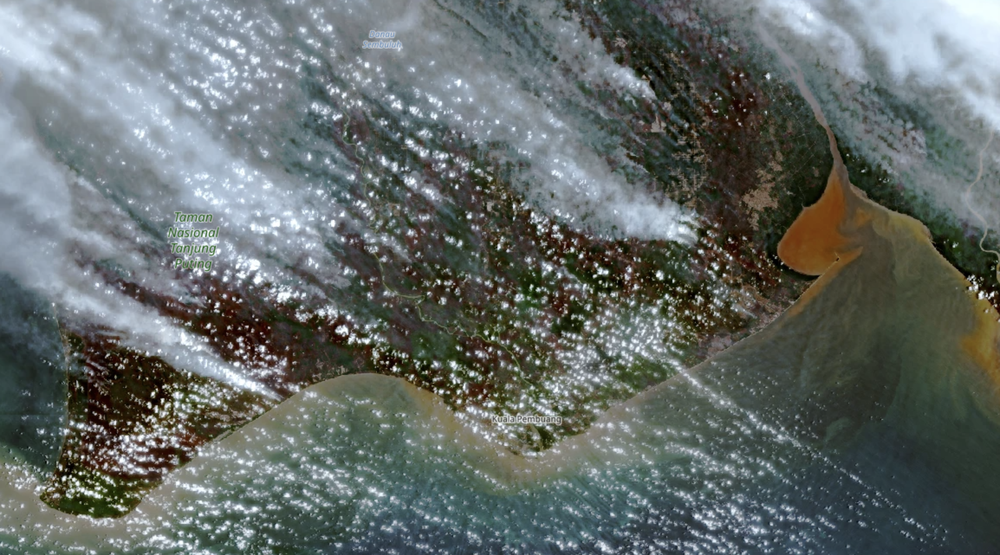
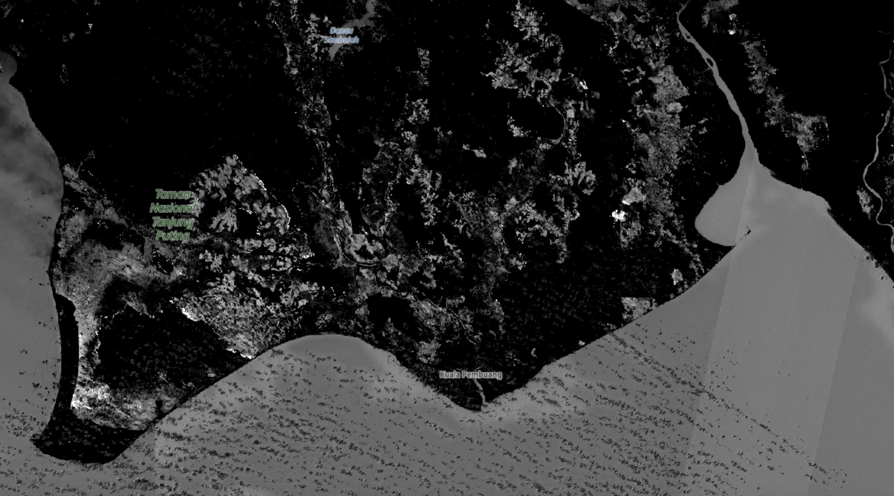
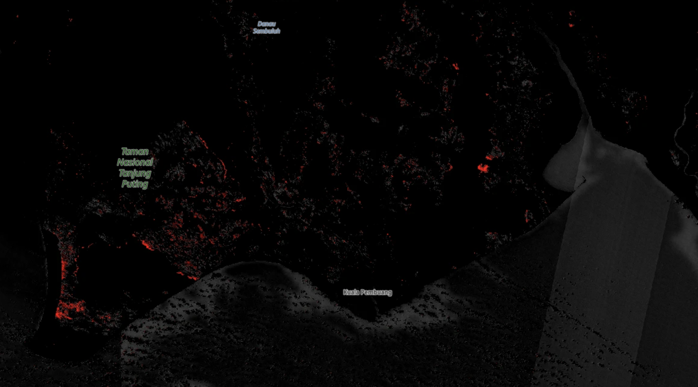

# SWIR-Based Fire Visualization Using Sentinel-2

**Original script and red-highlighted visualization**

**Authors:** Adzanil Rachmadhi Putra and Fatwa Ramdani

## Overview

This repository provides a Sentinel-2 SWIR-based visualization script for exploring spectral patterns associated with potential fire-affected areas.

The repository includes two versions of the script:

- **Original visualization:** Uses `HighlightCompressVisualizerSingle` to display a spectral index calculated from Sentinel-2 SWIR bands B11 and B12. Also available at: https://custom-scripts.sentinel-hub.com/custom-scripts/sentinel-2/fire_boundary/
- **Updated visualization:** Highlights pixels exceeding a user-defined index threshold in red while displaying the remaining pixels in grayscale.

The updated version is designed to make potential areas of interest easier to distinguish from the surrounding landscape.

## Original Script

The original script calculates the following index:

\[
I = 8.5 \times \frac{B12-B11}{B12+B11+0.25}
\]

It then applies `HighlightCompressVisualizerSingle` to visualize the calculated values.

```javascript
//VERSION=3 (auto-converted from 1)
/*
Authors of the script: Adzanil Rachmadhi Putra, Fatwa Ramdani
*/

function setup() {
  return {
    input: [{
      bands: [
        "B11",
        "B12"
      ]
    }],
    output: { bands: 1 }
  };
}

let viz = new HighlightCompressVisualizerSingle(-1.0, 1.0);

function evaluatePixel(samples) {
  let val = 8.5 * (samples.B12 - samples.B11) /
            (samples.B12 + samples.B11 + 0.25);

  return viz.process(val);
}
```

## Updated Script: Red-Highlighted Visualization

The updated script retains the original index calculation but replaces the original visualization with a custom RGB color scheme.

- **Red:** Pixels with index values greater than 0.15.
- **Grayscale:** Pixels below or equal to the threshold.
- **Black and dark gray:** Low-intensity background pixels.

```javascript
//VERSION=3
/*
Authors: Adzanil Rachmadhi Putra, Fatwa Ramdani
SWIR-based fire visualization
*/

function setup() {
  return {
    input: [{
      bands: ["B11", "B12"]
    }],
    output: {
      bands: 3
    }
  };
}

function evaluatePixel(samples) {
  let val = 8.5 * (samples.B12 - samples.B11) /
            (samples.B12 + samples.B11 + 0.25);

  // Background: black to grey
  let grey = Math.max(
    0,
    Math.min(0.45, (val + 0.2) * 0.8)
  );

  // Highlight higher index values in red
  if (val > 0.15) {
    let intensity = Math.min(1, (val - 0.15) / 0.5);
    return [intensity, 0, 0];
  }

  return [grey, grey, grey];
}
```

## How to Use

1. Open [[Copernicus Browser]((https://browser.dataspace.copernicus.eu/)).
2. Search and select Sentinel-2 L2A imagery.
3. Select your area of interest and acquisition date.
4. Under LAYER menu, scroll down and select CUSTOM.
5. Copy and paste the script, and apply the visualization.
6. For the updated script, adjust the red threshold and grayscale brightness to explore different spectral patterns.

### Data and Band Information

| Band | Description | Native spatial resolution |
|---|---|---|
| B11 | SWIR 1 | 20 m |
| B12 | SWIR 2 | 20 m |

## Customization

You can modify the updated visualization by changing three parameters:

| Parameter | Default | Effect |
|---|---:|---|
| Red threshold | 0.15 | Higher values generally highlight fewer pixels. |
| Red intensity scale | 0.5 | Controls how quickly the red channel reaches full intensity. |
| Maximum grayscale brightness | 0.45 | Controls the brightness of the grayscale background. |

These are visualization parameters, not validated fire-detection thresholds.

## Interpretation and Limitations

This script is intended for visual exploration of SWIR spectral patterns that may be associated with fire-affected surfaces.

**Important limitations:**

- Red pixels do not necessarily indicate confirmed active fires.
- The B11–B12 index is not a validated standalone active-fire detection algorithm.
- Clouds, surface characteristics, vegetation, and acquisition conditions can affect the resulting image.
- Sentinel-2 is an optical satellite system. Neither version can reveal ground fires through optically thick clouds.

For active-fire monitoring, consider complementary thermal-anomaly observations from [NASA FIRMS](https://firms.modaps.eosdis.nasa.gov/), which provides active-fire information derived from satellite observations.

## Visualization Examples

The following examples illustrate the difference between the natural-colour image, the original SWIR-based visualization, and the updated red-highlighted version.

### Natural Colour Visualization



*Figure 1. Natural-colour visualization using Sentinel-2 imagery.*

### Original Visualization



*Figure 2. Original visualization using the B11–B12 spectral index and `HighlightCompressVisualizerSingle`.*

### Updated Red-Highlighted Visualization



*Figure 3. Updated visualization highlighting pixels exceeding a user-defined spectral-index threshold in red, while displaying other pixels in grayscale.*

**Note:** Red pixels represent spectral-index threshold exceedances, not confirmed active fires. Both visualizations are subject to cloud obstruction and other limitations of optical satellite imagery.

## Reuse and Attribution

Researchers, students, and practitioners are welcome to use this code as a starting point for their own remote-sensing visualization workflows, subject to the repository's license and applicable third-party terms.

When reusing or adapting the original script, please acknowledge:

**Adzanil Rachmadhi Putra and Fatwa Ramdani**

Please retain the original authorship comments when adapting the code. Before redistributing the scripts, check the repository's license and any applicable source-code attribution requirements.

## How to Cite This Code

If you use or adapt this script in academic research, please cite the repository using APA 7th edition.

**APA reference**

Rachmadhi Putra, A., & Ramdani, F. (2026). *SWIR-based fire visualization using Sentinel-2* [Source code]. GitHub. https://github.com/fatwaramdani/Forest-Fire-Visualization/

**In-text citation:** (Rachmadhi Putra & Ramdani, 2026)

**Narrative citation:** Rachmadhi Putra and Ramdani (2026)

When reusing the code, retain the original authorship attribution and comply with the repository's license and applicable third-party terms.

## Acknowledgment

This repository builds on the original SWIR-based visualization script by Adzanil Rachmadhi Putra and Fatwa Ramdani and introduces a red-highlighted visualization to facilitate the inspection of potential fire-related spectral patterns.
